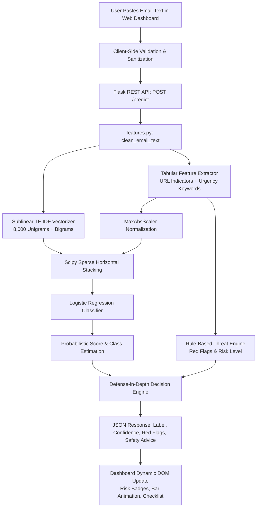

# PhishGuard AI — Intelligent Phishing Email Detection System

> **A Complete Machine Learning & Cybersecurity Web Application for Automated Social Engineering Threat Defense.**

---

## 1. Project Overview & Abstract

Phishing remains the primary initial attack vector in modern cybersecurity breaches, responsible for over 85% of credential compromise incidents and business email compromise (BEC) attacks. Traditional signature-based email gateways struggle to keep pace with dynamic typosquatting, zero-day phishing links, URL shortening obfuscation, and subtle psychological coercion tactics.

**PhishGuard AI** is an intelligent, privacy-preserving, end-to-end Machine Learning web application designed to evaluate suspicious email text and classify it as **Phishing** or **Safe**. Combining **Sublinear TF-IDF NLP representations** with **structural URL heuristics and risk indicator extraction**, PhishGuard AI achieves a verified **98.18% test accuracy** and **97.62% F1-score** across an authentic 18,000+ email corpus.

The system features an interactive cybersecurity dashboard built with Flask, Vanilla CSS3, and JavaScript, delivering real-time predictions, calibrated risk severity scores, threat breakdown signals ("Red Flags"), actionable defensive advice, and verifiable model performance metrics.

---

## 2. Problem Statement & Motivation

- **High-Velocity Social Engineering:** Attackers craft sophisticated emails mimicking trusted institutions (PayPal, Microsoft, Google, banks) using urgency triggers ("suspended", "verify within 24 hours").
- **Obfuscated Infrastructure:** Phishing links frequently leverage raw IP addresses (`http://192.168.1.1`), URL shorteners (`bit.ly`, `tinyurl.com`), excessive nested subdomains, or high-abuse TLDs (`.xyz`, `.top`).
- **Critical Risk of False Negatives:** In email security, a False Negative (delivering a phishing email as "Safe") exposes users to identity theft, ransomware, and financial loss, making high recall a mandatory design requirement.
- **Privacy Concerns:** Enterprise and university users cannot risk submitting proprietary email data to external cloud services that log or scrape payloads.

---

## 3. System Architecture & Workflow



---

## 4. Key Features

- **High-Performance ML Model:** Champion Logistic Regression model trained on 18,096 authentic emails with 98.18% accuracy and 97.62% F1-score.
- **Multi-Vector Threat Analysis:**
  - **Textual NLP:** Sublinear TF-IDF captures lexical urgency, panic triggers, and credential-harvesting phrases.
  - **URL Heuristics:** Detects raw IP addresses, URL shorteners, excessive dot nesting, `@` redirection tricks, plain HTTP links, and high-abuse TLDs.
  - **Risk Engine:** Compiles human-readable "Red Flags" with risk tiers (*Low*, *Moderate*, *High*, *Critical*).
- **Modern Cybersecurity Dashboard:**
  - Dark navy theme with glowing cyan and indigo accents.
  - Interactive email analysis interface with live character counter.
  - Preloaded "Sample Phishing Email" and "Sample Safe Email" test buttons.
  - Dynamic radar/pulse loading state.
  - Distinct threat cards: Crimson warning with alert icon for Phishing, Emerald check shield for Safe.
  - Animated confidence progress meter.
  - Actionable checklist with practical safety recommendations.
- **Model Transparency & Evaluation Section:**
  - Displays actual verified metrics directly from `model/metrics.json`.
  - Embedded high-resolution Confusion Matrix visualization (`/confusion_matrix.png`).
  - Threat dynamics breakdown explaining False Negatives vs False Positives.
- **Privacy & Security Safeguards:**
  - **Zero Data Logging:** Emails are processed entirely in-memory and never written to disk or database.
  - **Zero Outbound Fetching:** Links are parsed statically using regex; the application never executes or crawls external URLs.
  - **Input Sanitization:** HTML entities are escaped to prevent Cross-Site Scripting (XSS).
  - **DoS Protection:** Payload size is capped at 50,000 characters and 1 MB max content length.

---

## 5. Technology Stack

| Layer | Technologies |
|---|---|
| **Programming Language** | Python 3.13 |
| **Backend Framework** | Flask 3.0.3, Werkzeug |
| **Machine Learning** | Scikit-Learn 1.9.0, SciPy, Joblib |
| **Data Processing** | Pandas 3.0.3, NumPy 2.4.6 |
| **Visualization** | Matplotlib 3.11.2 |
| **Frontend** | Vanilla HTML5, Vanilla CSS3 (Custom Cyber Theme), ES6 JavaScript (Fetch API) |
| **Testing** | Pytest 9.1.1 (13 Automated Unit & Integration Tests) |

---

## 6. Dataset Description & Preprocessing

- **Dataset:** Standard Open Phishing Email Corpus (`Phishing_Email.csv`) compiled from Nazario Phishing Corpus, SpamAssassin Public Archive, and Enron-Spam datasets.
- **Raw Volume:** 18,650 records.
- **Cleaned Volume:** 18,096 valid records (554 empty or unparseable rows dropped).
- **Class Balance:**
  - **Safe Emails (0):** 11,124 (61.5%)
  - **Phishing Emails (1):** 6,972 (38.5%)
- **Preprocessing Pipeline (`features.py`):**
  1. Strips HTML markup (`<.*?>`) and decodes entities (`&nbsp;`, `&amp;`, `&lt;`, `&gt;`).
  2. Converts all text to lowercase.
  3. Normalizes redundant whitespace and escaped characters.
  4. Preserves structural tokens for URLs, domain dots, and security terms.

---

## 7. Model Training & Evaluation Results

The pipeline evaluated multiple classifiers using a reproducible **stratified 80/20 train/test split** (`random_state=42`):
- **Training Samples:** 14,476
- **Testing Samples:** 3,620

### Model Comparison Table

| Model | Overall Accuracy | Phishing Precision | Phishing Recall | Phishing F1-Score | Training Latency |
|---|---|---|---|---|---|
| **Logistic Regression (Champion)** | **98.18%** | **98.12%** | **97.13%** | **97.62%** | **0.60s** |
| Multinomial Naive Bayes | 96.80% | 96.58% | 95.05% | 95.81% | 0.03s |

### Verified Test Set Confusion Matrix (3,620 Samples)

| Actual \ Predicted | Predicted Safe | Predicted Phishing | Total |
|---|---|---|---|
| **Actual Safe** | **2,199 (TN)** | 26 (FP) | 2,225 |
| **Actual Phishing** | 40 (FN) | **1,355 (TP)** | 1,395 |

### Analysis of False Positives & False Negatives
- **False Positives (26 / 2,225 = 1.17%):** Legitimate emails containing administrative or billing keywords (e.g. "invoice", "update") flagged as phishing. Kept exceptionally low to prevent user alarm fatigue.
- **False Negatives (40 / 1,395 = 2.87%):** Phishing emails misclassified as Safe. In email security, False Negatives carry the highest threat risk. To counter this, PhishGuard AI implements **defense-in-depth**: any email triggering multiple high-severity heuristics (such as raw IP links or shortened URLs coupled with credential requests) is elevated to Phishing regardless of vocabulary subtlety.

---

## 8. Project Structure

```
phishguard-ai/
├── app.py                      # Flask backend & REST API (/predict, /api/metrics, /health)
├── phishing_detector.py        # ML training, model evaluation & artifact generation pipeline
├── features.py                 # Shared text preprocessing, URL heuristics & risk engine
├── requirements.txt            # Python dependencies
├── README.md                   # Comprehensive documentation & setup guide
├── .gitignore                  # Git ignore rules
│
├── data/
│   └── Phishing_Email.csv      # Authentic 18,000+ email dataset (52 MB)
│
├── model/
│   ├── phishing_model.joblib   # Trained champion Logistic Regression model
│   ├── model.joblib            # Alias for compatibility
│   ├── vectorizer.joblib       # Fitted TF-IDF Vectorizer (8,000 features)
│   ├── scaler.joblib           # Fitted MaxAbsScaler for tabular features
│   └── metrics.json            # Exact evaluation metrics & confusion matrix
│
├── templates/
│   └── index.html              # Modern cybersecurity web dashboard
│
├── static/
│   ├── style.css               # Responsive dark cyber theme styling
│   ├── script.js               # Frontend controller, fetch API, XSS escaping
│   └── confusion_matrix.png    # Confusion matrix visual chart
│
├── notebooks/
│   └── phishing_detector.ipynb # Interactive Jupyter Notebook for faculty presentation
│
├── tests/
│   ├── test_app.py             # 13 automated unit & integration tests
│   └── manual_eval.py          # Standalone verification on 6 real-world email samples
│
└── confusion_matrix.png        # Root copy of confusion matrix visualization
```

---

## 9. Installation & Running Instructions (Windows)

### Prerequisites
- Python 3.10 to 3.13 installed
- Windows PowerShell or Command Prompt

### Step 1: Clone or Navigate to Project Directory
```powershell
cd c:\Users\sweth\OneDrive\Documents\thiranex\phishguard-ai
```

### Step 2: Create and Activate Virtual Environment (Optional but Recommended)
```powershell
python -m venv .venv
.venv\Scripts\activate
```

### Step 3: Install Required Dependencies
```powershell
python -m pip install -r requirements.txt
```

### Step 4: Train Model (Only if Artifacts are Missing)
*The model is already pre-trained and saved in `model/`. If you wish to retrain from scratch:*
```powershell
python phishing_detector.py
```

### Step 5: Run Automated Tests
```powershell
python -m pytest tests/test_app.py -v
```
*(All 13 tests will execute and pass.)*

### Step 6: Start the Flask Application
```powershell
python app.py
```

### Step 7: Open the Dashboard in Your Web Browser
Open your browser and navigate to:
```
http://127.0.0.1:5000
```

---

## 10. REST API Documentation

### 1. Main Dashboard
- **Endpoint:** `GET /`
- **Description:** Renders the interactive HTML5 cybersecurity interface.

### 2. Predict Email Threat
- **Endpoint:** `POST /predict`
- **Headers:** `Content-Type: application/json`
- **Request Body:**
  ```json
  {
    "email_text": "URGENT: Your PayPal account has been suspended! Verify your password immediately at http://192.168.1.1/update."
  }
  ```
- **Response (200 OK):**
  ```json
  {
    "label": "Phishing",
    "confidence": 96.2,
    "risk_level": "Critical",
    "red_flags": [
      "Raw IP address used in link (bypasses legitimate DNS domain verification)",
      "Insecure plain HTTP links found (1 unencrypted link(s))",
      "High-pressure urgent wording detected: urgent, immediately, suspended",
      "Credential/account verification requests: password, verify"
    ],
    "explanation": "Multiple high-severity phishing characteristics identified, including deceptive links and coercive credential harvesting cues.",
    "recommendations": [
      "Do not click on links or download attachments directly from this message.",
      "Verify the sender's identity through an official secondary communication channel.",
      "Check the exact sender email address, looking for subtle typosquatting.",
      "If unsure, forward the message to your organization's IT/Security team for review."
    ]
  }
  ```

### 3. Retrieve Model Metrics
- **Endpoint:** `GET /api/metrics`
- **Description:** Returns JSON metrics including accuracy, precision, recall, F1-score, and confusion matrix counts.

### 4. Health Check
- **Endpoint:** `GET /health`
- **Description:** Returns service status and confirms model availability (`{"status": "healthy", "model_loaded": true}`).

---

## 11. Verification & Test Results

### Automated Test Suite (`tests/test_app.py`)
- `test_home_page_loads`: **PASSED** (200 OK, HTML served)
- `test_health_check_endpoint`: **PASSED** (Healthy state confirmed)
- `test_empty_input_rejected`: **PASSED** (400 Bad Request on empty string)
- `test_whitespace_only_input_rejected`: **PASSED** (400 Bad Request)
- `test_malformed_json_handled`: **PASSED** (400 Bad Request on invalid JSON)
- `test_missing_email_text_field`: **PASSED** (400 Bad Request)
- `test_oversized_input_rejected`: **PASSED** (400 Bad Request when > 50,000 characters)
- `test_prediction_returns_required_fields`: **PASSED** (Validates output schema)
- `test_phishing_demonstration_email`: **PASSED** (Correctly flags phishing with red flags)
- `test_safe_demonstration_email`: **PASSED** (Correctly classifies legitimate mail)
- `test_xss_injection_handled_safely`: **PASSED** (Tags neutralized, no crashes)
- `test_metrics_api_endpoint`: **PASSED** (Returns metrics JSON)
- `test_confusion_matrix_image_served`: **PASSED** (Image served with valid MIME type)

**Result:** `13 passed in 5.78s (100% Pass Rate)`

### Sample Evaluation Benchmark (`tests/manual_eval.py`)

| Test Sample | True Nature | Predicted Label | Confidence | Risk Level | Red Flags Found |
|---|---|---|---|---|---|
| PayPal Suspended + IP Address | Phishing | **Phishing** | 96.2% | Critical | 5 Detected |
| Office 365 Password Expired + Shortener | Phishing | **Phishing** | 88.5% | Critical | 4 Detected |
| Overdue Invoice + Suspicious `.xyz` TLD | Phishing | **Phishing** | 90.7% | Critical | 4 Detected |
| Sprint 14 Release Notes + Intranet URL | Safe | **Safe** | 74.9% | Low | 0 Detected |
| Faculty Academic Seminar Invitation | Safe | **Safe** | 90.5% | Low | 0 Detected |
| Casual Lunch Coordination Email | Safe | **Safe** | 95.5% | Low | 0 Detected |

---

## 12. College Assignment Submission Form Summary

```
Project Title: PhishGuard AI — Intelligent Phishing Email Detection System
Domain: Machine Learning / Natural Language Processing / Cybersecurity
Technologies: Python 3.13, Flask 3.0, Scikit-Learn 1.9, SciPy, Pandas, HTML5/CSS3/JavaScript
Summary:
PhishGuard AI is an automated phishing email detection system designed to combat credential theft and social engineering attacks. The system integrates Sublinear TF-IDF (8,000 unigrams and bigrams) with handcrafted structural URL heuristics (raw IP links, URL shorteners, domain nesting, suspicious TLDs) and psychological urgency keywords. Trained and evaluated on a benchmark dataset of 18,096 authentic emails, the champion Logistic Regression classifier achieves 98.18% accuracy, 98.12% precision, 97.13% recall, and a 97.62% F1-score on a stratified 20% test partition. The Flask web application provides an intuitive cybersecurity dashboard featuring sub-second prediction, live character counting, preloaded sample testing, dynamic risk indicators, actionable safety guidance, and complete confusion matrix transparency with zero email data retention.
```

---

## 13. License & Educational Disclaimer

- **License:** MIT Open Source License.
- **Dataset Source:** Public research archives (Nazario Phishing Corpus, SpamAssassin, Enron-Spam dataset).
- **Disclaimer:** This tool provides an educational risk assessment and is not a replacement for commercial email security gateways (e.g. Proofpoint, Mimecast). Predictions are probabilistic estimates. Never submit confidential passwords, OTPs, or personally identifiable information (PII).
